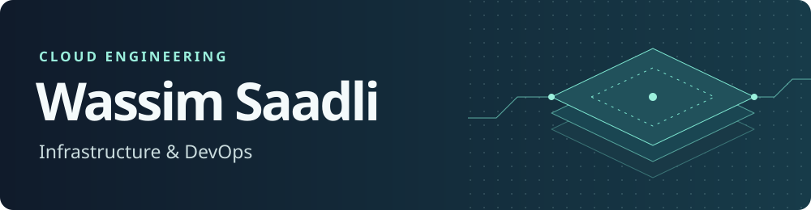

I'm a cloud engineering student at **ESPRIT in Tunis**. I like following a web request from the network to the container that serves it. In my labs, I configure Linux servers, run services with Docker Compose, and test what happens when a container restarts.

**Currently exploring** &nbsp; Linux networking · AWS infrastructure · CI/CD

[Visit my portfolio ↗](https://wassimsaadli.me/) &nbsp; · &nbsp; [Connect on LinkedIn ↗](https://www.linkedin.com/in/wassimsaadli/)
